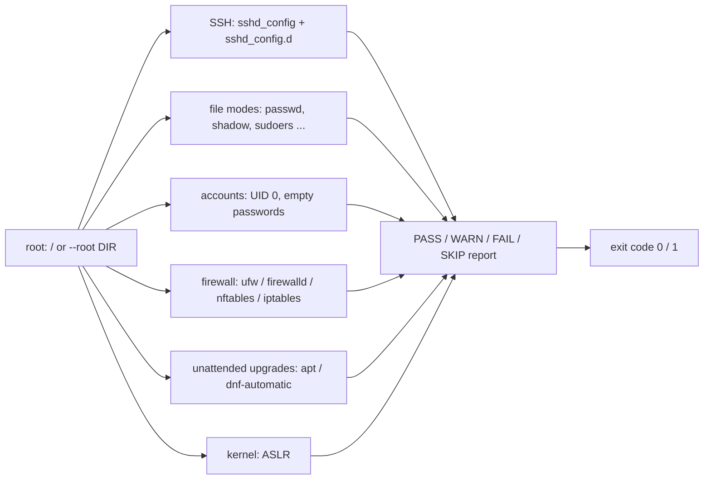

# linux-hardening-audit

[](https://github.com/AJJudkins/linux-hardening-audit/actions/workflows/ci.yml)

A **read-only** Python script that checks a handful of common Linux hardening settings on the local machine and prints a pass / warn / fail report. It **never modifies the system**: it only reads config files, file modes and `/proc/sys`, runs no external commands, opens no network connections, and never prints password hashes. Fix suggestions are printed as text hints only.

## How it works


## Checks
| Area | What is checked |
|------|-----------------|
| SSH | `PermitRootLogin`, `PasswordAuthentication`, `PermitEmptyPasswords`, `X11Forwarding`, `MaxAuthTries` (first occurrence wins; drop-ins read first; unset values are shown as "OpenSSH default") |
| Files | modes (and root ownership) of `/etc/passwd`, `/etc/group`, `/etc/shadow`, `/etc/gshadow`, `sshd_config`, `/etc/sudoers` |
| Accounts | extra UID 0 accounts; empty password fields (needs root to read `/etc/shadow`, otherwise SKIP) |
| Firewall | ufw enabled, firewalld running, nftables config, or iptables tables loaded (detected from files, not by running commands) |
| Updates | apt `20auto-upgrades` / dnf-automatic timer |
| Kernel | `kernel.randomize_va_space` (ASLR) |

## Setup
```bash
git clone https://github.com/AJJudkins/linux-hardening-audit.git
cd linux-hardening-audit
# Python 3.9+, standard library only
pip install -e ".[dev]"     # optional: console script + pytest
```

## Usage
```bash
python hardening_audit.py                  # audit this machine (run as root to read /etc/shadow)
python hardening_audit.py --json
python hardening_audit.py --strict         # WARN also gives a non-zero exit code (CI / cron)
python hardening_audit.py --root /mnt/image   # audit a mounted filesystem tree instead of /
linux-hardening-audit                      # console script after pip install
```
Exit codes: `0` no FAIL (and no WARN with `--strict`), `1` at least one FAIL (or WARN with `--strict`), `2` usage error.

Sample output (from the container this was developed in, abridged):
```text
Linux hardening audit (read-only)
=================================
[SKIP] ssh       sshd_config              no sshd_config found or readable (sshd not installed?)
[PASS] files     /etc/passwd              mode 0644
[PASS] files     /etc/shadow              mode 0640
[WARN] firewall  host-firewall            no host firewall (ufw/firewalld/nftables/iptables) detected
         hint: Enable a host firewall, or confirm one is enforced upstream (e.g. cloud security groups).
[PASS] kernel    aslr                     kernel.randomize_va_space=2
```

## Tests
```bash
pip install -e ".[dev]"
pytest
```
Tests build fake filesystem trees in temporary directories and run the audit with `--root`, including a test that the audit leaves the tree byte-for-byte unchanged and that password hashes never appear in output.

## Limitations
- A small, opinionated checklist, **not** a CIS benchmark or compliance scan; a clean report does not mean the system is secure.
- Reads configuration files only, so it cannot see runtime state: a service can be configured but not running, and firewall rules are not inspected (only whether a firewall appears to be enabled).
- SSH settings are read from `sshd_config` and `sshd_config.d/*.conf` without evaluating `Match` blocks or `Include` ordering beyond "drop-ins first, first value wins".
- Developed and run in a Linux container; it has not been run against a range of distributions or hardened production hosts. Many checks SKIP when files are absent or unreadable.

## Security and testing status

- **Safety:** read-only: reads config files, file modes and `/proc/sys`; runs no commands, opens no network connections, never modifies the system and never prints password hashes. Hints are text only.
- **Tested:** every check against fake filesystem trees built in temporary directories, a byte-for-byte 'tree unchanged' test, and one run on the development container's real `/`.
- **Not tested:** a range of real distributions and hardened production hosts, SSH `Match` blocks, runtime firewall state, and running as root against real `/etc/shadow` on a multi-user system.
- See [SECURITY.md](SECURITY.md).

## License
MIT
